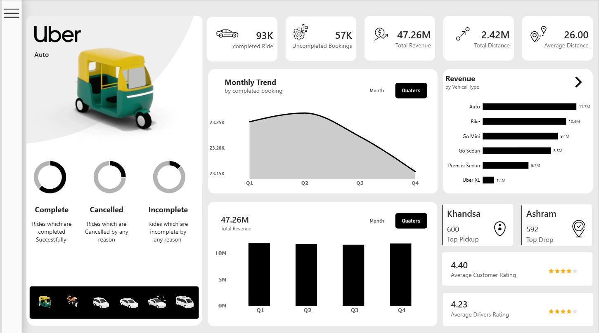
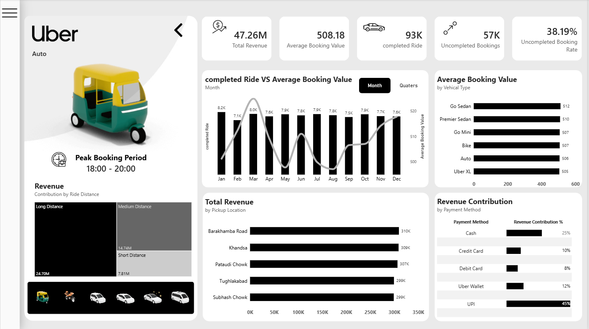

# 🚕 Uber Ride Analytics Dashboard

An interactive Power BI dashboard designed to explore ride bookings, revenue, vehicle performance, trip patterns, pickup and drop locations, and customer and driver ratings. The report includes an overview page and a dedicated revenue analysis page, with filters that allow users to investigate the data by month, payment method, and vehicle type.

## 1. Project Overview

Ride-hailing platforms generate large volumes of booking and trip data. Looking at this information in raw tables can make it difficult to understand booking outcomes, revenue performance, customer demand, and differences between vehicle categories.

This project uses Power BI to turn ride-booking data into an interactive report. It helps users monitor key metrics, compare vehicle types, explore monthly and quarterly trends, and examine how revenue varies across locations, trip distances, and payment methods.

## 2. Tech Stack

The dashboard was developed using the following tools and technologies:

- 📊 **Power BI Desktop** – Main platform used to build the interactive report and visuals.
- 🔄 **Power Query** – Used to prepare and transform the data.
- 🧮 **DAX** – Used to create measures and calculated metrics for bookings, revenue, average booking value, and booking rates.
- 🧩 **Data Modeling** – Used to organize the data for analysis and enable interactions between report visuals.
- 🖼️ **Power BI visuals and slicers** – Used to present KPIs, trends, comparisons, and interactive filters.
- 📁 **File format** – Power BI report (`.pbix`) and dashboard preview images.

## 3. Data Analysis

The dashboard analyzes ride-booking information, including fields or categories represented in the report such as:

- Booking status (completed, cancelled, and incomplete)
- Booking value and revenue
- Vehicle type
- Booking date/month and time
- Pickup and drop locations
- Ride distance
- Payment method
- Customer and driver ratings

## 4. Dashboard Features & Highlights

### Business Problem

Ride-booking data contains information about booking outcomes, revenue, vehicle categories, locations, and customer experience. Without a consolidated view, it can be challenging to identify demand patterns, compare vehicle performance, and understand which factors contribute to revenue.

### Project Goals

The dashboard is designed to:

- Monitor completed and uncompleted bookings.
- Track total revenue and average booking value.
- Compare revenue and booking performance across vehicle types.
- Explore monthly and quarterly booking and revenue trends.
- Identify frequently used pickup and drop locations.
- Examine ride-distance and payment-method contributions.
- Review customer and driver rating metrics.

### Dashboard Walkthrough

#### Page 1: Overview

The Overview page provides a high-level view of ride operations and performance.

**Key KPI cards**

- Completed Rides
- Uncompleted Bookings
- Total Revenue
- Total Distance
- Average Distance

**Booking Status**

- Donut charts show the distribution of completed, cancelled, and incomplete rides.

**Monthly Trend**

- An area/line-style visual shows completed bookings across the months.
- A Month/Quarters toggle allows users to change the time aggregation.

**Revenue by Vehicle Type**

- A horizontal bar chart compares revenue across vehicle categories, including Auto, Bike, Go Mini, Go Sedan, Premier Sedan, and Uber XL.

**Revenue Trend**

- A column chart displays revenue across the months or quarters.

**Pickup and Drop Insights**

- Cards highlight the top pickup and top drop locations in the current filter context.

**Ratings**

- Cards display average customer rating and average driver rating.

**Vehicle Type Selector**

- An interactive vehicle selector allows users to focus the report on a selected vehicle category.

#### Page 2: Revenue Analysis

The Revenue page focuses on booking value and revenue composition.

**Key KPI cards**

- Total Revenue
- Average Booking Value
- Completed Rides
- Uncompleted Bookings
- Uncompleted Booking Rate

**Completed Rides vs Average Booking Value**

- A combined chart compares monthly completed rides with average booking value.
- The Month/Quarters toggle changes the time view.

**Average Booking Value by Vehicle Type**

- A horizontal bar chart compares average booking value across vehicle categories.

**Revenue by Pickup Location**

- A bar chart ranks pickup locations by total revenue.

**Revenue Contribution by Payment Method**

- A visual compares the contribution of payment methods such as Cash, Credit Card, Debit Card, Uber Wallet, and UPI.

**Revenue Contribution by Ride Distance**

- A treemap groups revenue into Long Distance, Medium Distance, and Short Distance categories.

**Peak Booking Period**

- A highlighted KPI displays the peak booking time period.

**Vehicle Type Selector**

- The same vehicle selector makes it possible to examine revenue metrics for individual vehicle categories.

### Interactive Filters

The recording demonstrates a filter panel with:

- **Month** – Select one or more months.
- **Payment Method** – Filter the report by payment method.
- **Vehicle Type** – Select a vehicle category using the vehicle selector.
- **Clear All Slicers** – Reset the slicer selections.

The report visuals respond to the selected filters, allowing users to explore different segments of the booking data.

## 5. Sample Observations

The following values are visible in the recording and represent the dashboard's displayed state. They may change when filters are applied.

- The Overview page displays approximately **93K completed rides**, **57K uncompleted bookings**, and **47.26M total revenue** in its unfiltered-looking view.
- The Overview page shows **Auto** as the highest-revenue vehicle category in the displayed comparison, at approximately **11.7M**.
- The Revenue page displays an **average booking value of 508.18** and an **uncompleted booking rate of 38.19%** in its displayed state.
- The highlighted peak booking period is **18:00–20:00**.
- In the displayed average-booking-value comparison, **Go Sedan** is approximately **512**, while **Uber XL** is approximately **505**.
- The Revenue page's ride-distance treemap shows Long Distance as the largest displayed contribution in the recording.

These are dashboard observations, not independently verified business conclusions. Values depend on the active filters and the underlying dataset.

## 6. Business Use Cases

- **Operations Monitoring:** Track completed, cancelled, and incomplete bookings.
- **Revenue Analysis:** Monitor revenue trends and compare vehicle categories.
- **Demand Analysis:** Explore booking patterns by month, quarter, and time period.
- **Location Analysis:** Identify pickup and drop locations with higher activity or revenue.
- **Payment Analysis:** Understand the contribution of different payment methods.
- **Customer Experience:** Monitor customer and driver ratings.

## 7. Screenshots / Demo

Add dashboard screenshots to the repository and update the paths below.

### Overview Page



### Revenue Analysis Page



**Demo recording:** Add a link to the uploaded dashboard walkthrough or a hosted video here.

## 8. How to Use

1. Download or clone this repository.
2. Open the `.pbix` file using **Power BI Desktop**.
3. If Power BI prompts for a data source, update the source path to the location of the dataset.
4. Refresh the data if required.
5. Use the month, payment method, and vehicle type filters to explore the report.
6. Navigate between the Overview and Revenue Analysis pages.

## 9. Repository Structure

```text
Uber-Ride-Analytics/
│
├── README.md
├── Uber-Ride-Analytics.pbix
├── data/
│   └── dataset-file
│
└── screenshots/
    ├── overview.png
    └── revenue-analysis.png
```

_Update the file and folder names above to match the actual repository contents. Do not upload source data if it is restricted or contains sensitive information._

## 10. Key Learnings

Through this project, I practised:

- Preparing and transforming data with Power Query.
- Building data models for reporting.
- Writing DAX measures for business KPIs.
- Designing interactive Power BI dashboards.
- Using slicers and time-based analysis to explore data.
- Comparing operational and revenue metrics.
- Presenting data in a format that supports business analysis.

---

**Created by:** Jay Pramod Raut  
**Tools:** Power BI Desktop | Power Query | DAX
